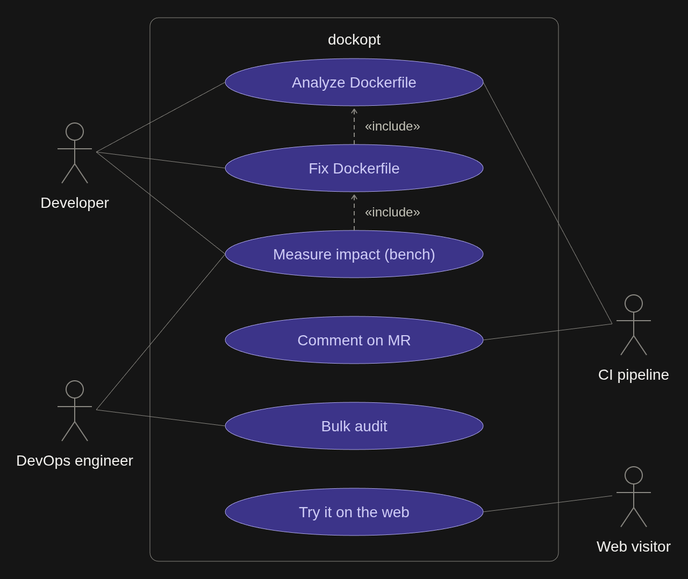

# Architecture

```
  cli/          ci/            web/ (wasm)
    \            |              /
     +-----------+-------------+
                 |
        +--------v---------+
        |      core        |   no I/O, no docker, no fs
        |                  |
        | parse -> analyze |
        |   -> fix -> render
        +--------+---------+
                 |
        +--------v---------+        +---------+
        |      bench       | -----> | report  |
        | docker sdk/trivy |        | txt/json/md
        +------------------+        +---------+


```

## Use cases


## Core

Everything in `internal/core` is pure. It takes bytes in and gives
bytes + findings out. The only reason for this is the wasm build for the
web demo: the docker client doesn't compile to wasm, so it can't
leak into core.

Flow:

1. `parser` wraps buildkit's parser and converts its node tree into
   my own `model.Dockerfile`. I don't use buildkit's AST directly,
   it's awkward to mutate.
2. `analyzer` runs every registered rule. Rules get an
   `AnalysisContext` (the parsed file + .dockerignore + detected
   language), not just the AST, because some rules need to know
   whether it's a Go or a Node project.
3. `fixer` applies fixes one at a time and re-parses after each one.
   Two fixes touching the same instruction would otherwise fight.
   It stops when nothing changes or after 10 passes.
4. `renderer` writes the file back. Untouched instructions keep their
   original raw text (comments, line continuations, weird spacing),
   and only modified ones get re-rendered. That keeps diffs small,
   and small diffs are what people will actually merge.

## Rules

One file per rule in `internal/core/rules`. A rule implements `Check`;
if it can fix things, it also implements `Fix`. They register
themselves in `init()`.

Rule IDs are stable (`DO001`...). Once an ID is published it doesn't
get reused, since people will put them in ignore lists.

## Bench

This is the only part that talks to docker. It builds the original
and the fixed version and measures:

- final image size and layer count
- cold build time
- warm build time after touching one source file (this is the number
  that shows whether cache ordering actually worked)
- optionally CVE count via trivy
