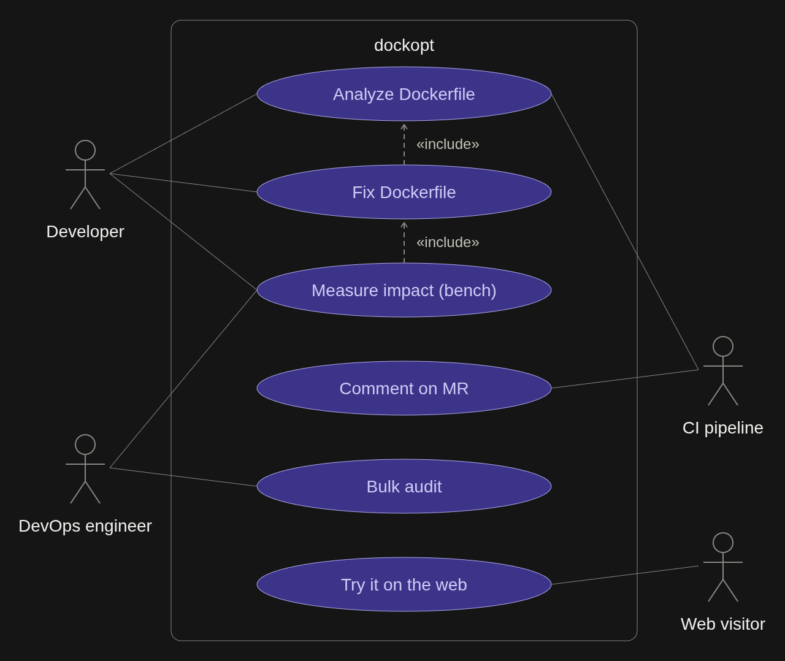

# dockopt

Finds and fixes problems in Dockerfiles: slow cache ordering, bloated
layers, root containers, deprecated syntax. It can then build the original
and the fixed image to show what the fixes actually bought.

```
$ dockopt analyze examples/go-api
examples/go-api/Dockerfile
     1  warning DO008  the final stage has no USER, the container runs as root
     1  warning DO010  the final image is golang:1.22 and builds the binary itself; build in a separate stage ...
     2  info    DO012  MAINTAINER is deprecated, use LABEL org.opencontainers.image.authors (fixable)
     6  warning DO002  apt-get install without --no-install-recommends (fixable)
     6  warning DO003  apt lists are not removed in this RUN, add `rm -rf /var/lib/apt/lists/*` (fixable)
     6  info    DO004  this RUN can be merged into the RUN on line 5 (fixable)
     8  warning DO005  the whole context is copied before Go modules are installed (line 9); copy go.mod go.sum first ...
     8  warning DO006  the whole context is copied but there is no .dockerignore
    12  warning DO014  CMD in shell form won't receive signals, use exec form ["..."] (fixable)

1 file, 0 errors, 7 warnings, 2 info; 6 fixable, run `dockopt fix -w`
```

## Install

```sh
go install github.com/alfacentaur1/dockopt/cmd/dockopt@latest
```

or build from source with `make build` (the binary ends up in `bin/`).

## Usage

```sh
dockopt analyze                    # ./Dockerfile; exit 1 on warnings and errors
dockopt analyze api/ worker/Dockerfile.prod --format json
dockopt fix                        # print the fixed Dockerfile
dockopt fix -diff                  # show what would change
dockopt fix -w                     # write the fixes back
dockopt fix -check                 # exit 1 if something is fixable (CI)
dockopt audit .                    # every Dockerfile in the repo + the most common problems
dockopt bench --runs 3             # build both versions and compare them
dockopt ci                         # comment on the current merge request
dockopt rules                      # list rules; `dockopt rules DO005` explains one
```

Common flags: `--format text|json|md`, `--ignore DO001,DO004`,
`--severity warning` (hide infos), `--fail-on error|warning|info|never`,
`--context dir` (build context, default is the Dockerfile's directory).

Findings can be silenced inline:

```dockerfile
# dockopt:ignore-file DO008
# dockopt:ignore DO001
FROM node
```

`# dockopt:ignore` without IDs silences every rule for the next instruction.

## Rules

| ID | Severity | Fix | Rule |
|---|---|:-:|---|
| `DO001` | warning |  | Pin the base image version |
| `DO002` | warning | ✓ | Skip recommended apt packages |
| `DO003` | warning | ✓ | Remove apt lists in the same layer |
| `DO004` | info | ✓ | Merge consecutive RUN instructions |
| `DO005` | warning | ✓ | Install dependencies before copying the source |
| `DO006` | warning |  | Use a .dockerignore |
| `DO007` | info | ✓ | Prefer COPY over ADD |
| `DO008` | warning |  | Don't run as root |
| `DO009` | info | ✓ | Don't keep the pip cache |
| `DO010` | warning |  | Use a multi-stage build for compiled code |
| `DO011` | info |  | Use WORKDIR instead of cd |
| `DO012` | info | ✓ | MAINTAINER is deprecated |
| `DO013` | warning | ✓ | apk add --no-cache |
| `DO014` | warning | ✓ | Use exec form for CMD and ENTRYPOINT |
| `DO015` | info |  | Don't upgrade packages in the image |

DO005 knows Go modules, npm/yarn/pnpm and pip. The project language comes
from the build context (`go.mod`, `package.json`, `requirements.txt`...)
or, failing that, from the base image.

## Bench

```
$ dockopt bench --runs 3 examples/go-api
examples/go-api/Dockerfile (6 fixes applied)

                original    fixed   change
   image size     1.1 GB   1.1 GB    -1.8%
       layers         12       13       +1
   cold build      24.0s    24.2s    +0.6%
   warm build      17.0s    13.9s   -18.4%

warm build = rebuild after touching main.go; build times are the median of 3 runs
```

The warm build is the interesting number: after the fix, changing a source
file no longer re-downloads every module. The image is still huge because
it ships the Go toolchain; that's DO010, which dockopt reports but doesn't
rewrite, since splitting a build into stages needs a human to decide what
the runtime image needs.

`--trivy` adds the CVE count (trivy has to be on `PATH`), `--touch` picks the
file to modify before the warm build. Base images are pulled before anything
is timed, so the first variant isn't penalized for the download.

## CI

**GitHub Actions** comments on the pull request and keeps updating the same
comment on every push:

```yaml
permissions:
  contents: read
  pull-requests: write
jobs:
  dockopt:
    runs-on: ubuntu-latest
    steps:
      - uses: actions/checkout@v4
      - uses: alfacentaur1/dockopt@main
        with:
          fail-on: warning
```

**GitLab** needs a project access token with the `api` scope in
`DOCKOPT_GITLAB_TOKEN`, see [examples/gitlab-ci.yml](examples/gitlab-ci.yml).

Outside a merge request `dockopt ci` just prints the comment, so you can
preview it locally. There's also a distroless image (`Dockerfile`) for CI
systems that prefer containers.

## Web demo

`make serve` builds the core to WebAssembly and serves the demo on
http://localhost:8080. Everything runs in the browser, nothing is uploaded.
Pushes to `main` publish it to GitHub Pages.

# Architecture

```
  cli/          ci/            web/ (wasm)
    \            |              /
     +-----------+-------------+
                 |
        +--------v---------+
        |      core        |   no I/O, no docker, no fs
        |                  |
        | parse -> analyze |
        |   -> fix -> render
        +--------+---------+
                 |
        +--------v---------+        +---------+
        |      bench       | -----> | report  |
        | docker sdk/trivy |        | txt/json/md
        +------------------+        +---------+


```

```
cmd/dockopt        CLI: analyze, fix, audit, bench, ci, rules
cmd/wasm           the core exposed to JavaScript
internal/model     my Dockerfile representation
internal/parser    buildkit parser -> model
internal/core      analyze + fixer, inline ignores, language detection
internal/core/rules  one file per rule
internal/core/render writes the model back to text
internal/diff      unified diffs (pure, also runs in wasm)
internal/report    text / json / markdown output
internal/bench     docker + trivy, the only part with side effects
internal/ci        github / gitlab comments
web/               the demo page
examples/          a deliberately bad Dockerfile and a GitLab CI job
```

## Use cases


## Core

Everything in `internal/core` is pure. It takes bytes in and gives
bytes + findings out. The only reason for this is the wasm build for the
web demo: the docker client doesn't compile to wasm, so it can't
leak into core.

Flow:

1. `parser` wraps buildkit's parser and converts its node tree into
   my own `model.Dockerfile`. I don't use buildkit's AST directly,
   it's awkward to mutate.
2. `analyze` runs every registered rule. Rules get a `rules.Context`
   (the parsed file + .dockerignore + detected language), not just the
   AST, because some rules need to know whether it's a Go or a Node
   project.
3. `fixer` applies fixes one at a time and re-parses after each one.
   Two fixes touching the same instruction would otherwise fight.
   It stops when nothing changes or after 10 passes, and never hands
   back something buildkit can't parse.
4. `render` writes the file back. Untouched instructions keep their
   original raw text (comments, line continuations, weird spacing),
   and only modified ones get re-rendered. Fixes edit the raw text where
   they can (adding a flag, appending a command), so even changed
   instructions keep their formatting. That keeps diffs small,
   and small diffs are what people will actually merge.

## Rules

One file per rule in `internal/core/rules`. A rule implements `Check`;
if it can fix things, it also implements `Fix`. They register
themselves in `init()`.

Rule IDs are stable (`DO001`...). Once an ID is published it doesn't
get reused, since people will put them in ignore lists.

## Bench

This is the only part that talks to docker. It builds the original
and the fixed version and measures:

- final image size and layer count
- cold build time
- warm build time after touching one source file (this is the number
  that shows whether cache ordering actually worked)
- optionally CVE count via trivy

Images are inspected, pulled and removed through the Docker SDK. Builds
go through `docker build`, so they run on BuildKit with the same cache
behaviour people get locally; driving BuildKit sessions through the SDK
would mean reimplementing half of the CLI.

## Development

```sh
make test     # go test -race -cover ./...
make lint     # go vet + golangci-lint
make build    # bin/dockopt
make web      # web/dockopt.wasm + wasm_exec.js
make serve    # web demo on :8080
```
